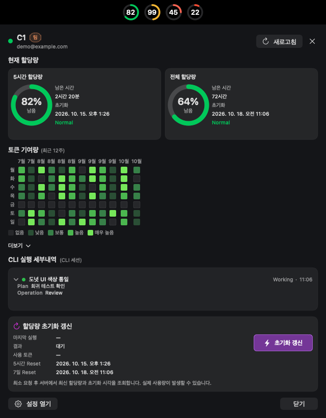
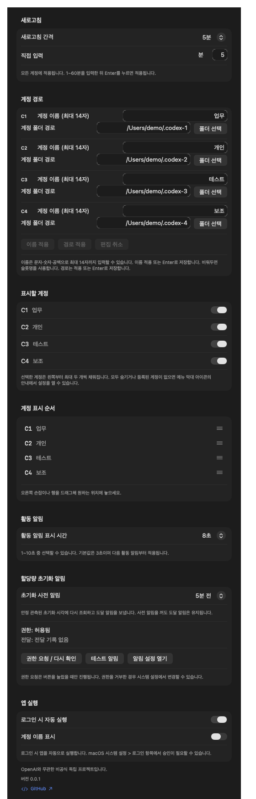

# Codex Quota Monitor

- macOS 메뉴 막대·노치용 Codex 계정 사용량 확인 앱



- 기본 화면 구성을 예시 계정·사용량으로 렌더링한 화면
- 화면의 이메일·경로·사용량·세션 정보는 예시 데이터
- 마지막 조회 시각·상태는 새로고침 버튼 옆 2행 표시
- 초기화 예정 안내·리셋권 버튼·시스템 알림의 동작은 아래 기능 설명 참고

## 주요 기능

### 사용량 UI

- 메뉴 막대·노치에서 최대 4개 Codex 계정의 남은 할당량 확인
- 중앙 숫자: 5시간 할당량 잔여율 / 외곽 링: 주간 할당량 잔여율
- 계정 클릭 시 상세 화면에서 두 할당량·초기화 시각·남은 시간 확인
- 노치 도넛의 소진 구간: 최초 실행·자동 갱신·수동 갱신에서 동일한 짙은 회색
- 주간 잔여량 0%인 경우 흰색 링 표시
- 새로고침 버튼 바로 왼쪽에 마지막 성공 조회 시각·현재 상태(`Normal`, `Loading`, `Timed out` 등) 표시
- 조회 실패 시 이전 성공 시각 유지, 현재 상태로 실패 여부 구분
- 할당량 카드에 남은 시간·초기화 시각 표시, 콘텐츠에 맞춘 카드 높이
- 새로고침 중 마지막 할당량·도넛 크기 유지
- Ping 결과 이후의 정상 갱신이 더 최신인 경우 최신 한도 우선 표시
- 작은 화면에 맞춘 상세 팝오버 크기 조정 및 세로 스크롤
- 구독 등급별 한글 뱃지와 등급 색상 표시, Go 명칭 유지

### 세션 활동

- 로컬에 기록된 Codex CLI·Codex App 작업의 최근 활동 확인
- 계정별 세션 제목·상태 표시 및 활동 알림
- 표시 계정 순서에 맞춘 알림 위치 및 숨김 계정 알림 제외

### 토큰 사용량

- Codex CLI가 로컬에 저장한 세션 기록(`CODEX_HOME/sessions`)의 토큰 정보 집계
- 서버 실시간 조회가 아닌 로컬 기록 기준
- 최근 24주(168일) 일별 잔디를 영역 너비의 2/3로 표시, 제목 오른쪽에 업데이트 버튼 배치
- 오른쪽 상세에 오늘 사용량 상시 표시, 날짜 호버 시 해당 일자로 전환 및 호버 해제 시 오늘 복귀
- 일별 토큰: 이벤트별 누적 증가분 기준, 자정을 넘긴 세션의 날짜별 분리
- 캐시 토큰: 기록의 `cached_input_tokens` 누적 증가분을 일별 집계, 잔디 상세 정보에 표시
- 캐시는 입력 토큰의 일부로 합계에 중복 가산 제외, 기록 미제공 시 `—` 표시
- 이전 저장 통계의 입력·출력 유지, 업데이트 버튼으로 24주·캐시 포함 재집계
- 세션 수: 마지막 유효 사용일 기준 파일당 한 번 산정
- 마지막 집계 시각 표시 및 날짜 변경 시 저장된 일별 통계의 기간 합계 재계산
- 파일 집계 상한 초과·읽기 실패 시 부분 통계 표시 제외 및 기존 성공 결과 보존
- 오늘·최근 7일·최근 30일의 입력·출력 토큰 확인
- 업데이트 버튼으로 사용량 다시 조회
- 계정별 최신 집계 결과의 SQLite 저장 및 앱 재실행 후 복원
- 마지막 성공 업데이트부터 14일 보관, 재업데이트 시 결과 교체·보관 기간 연장
- 계정 경로 변경 시 해당 계정 기록만 제거, 다른 계정 기록 유지

### 할당량 초기화 갱신

- 상세 화면의 `초기화 갱신` 버튼으로 최소 Ping 요청 실행
- Ping 성공 후 최신 5시간·7일 할당량과 초기화 시각 재조회
- 실행 결과·사용 토큰·초기화 시각 변화 표시
- 서버의 초기화 시각을 확인하는 기능이며 초기화 시각 변경 보장 없음
- 실제 요청에 따른 사용량 발생 가능

### 자동 새로고침·초기화 시각 판별

- 일반 조회: 기본 5분, 설정에서 1~1,440분 입력 및 1·5·10·30분 선택
- 새로고침 버튼: 해당 계정만 즉시 조회
- 초기화 시각: 첫 실행·자동 갱신·수동 새로고침의 정상 조회 1회부터 즉시 표시·알림 예약
- 이후 시각 이동 감지: 최소 60초 간격의 최근 3회 비교, 2초 오차 허용
- 동일한 예정 시각 유지와 조회 경과 시간만큼 이동하는 시각 구분
- 시각 이동 중: 초기화 시각 미확정 표시
- 계정·예정 시각 변경, 조회 실패, 만료, 시계 변경 후 다음 정상 조회 1회로 다시 반영
- 관측 이력: 실행 중 메모리에만 보관, 앱 재시작 후 첫 정상 조회부터 표시
- 반복 조회의 동일 결과만으로 서버의 초기화 시각 고정 여부 확정 불가

### 초기화 예정 알림

- 정상 조회로 확인한 초기화 시각에 해당 계정 재조회 후 macOS 도달 알림
- 설정의 `초기화 사전 알림`: 끔·10분 전·5분 전·3분 전 선택, 기본 5분 전
- 사전 알림 해제 시에도 예정 시각 도달 재조회·알림 유지
- 5시간·7일 한도별 독립 예약, 같은 계정의 두 한도 동시 도달 시 1회 조회
- 초기화 시각·계정 변경 시 예약 교체, 동일 예약의 반복 알림 방지
- `현재 할당량` 제목 옆 `N시간 N분 뒤 5시간 할당량이 초기화될 예정입니다.` 형식의 안내, 7일 한도 제외
- 절전 중 지난 사전 알림 생략, 복귀 시 지난 예정 시각 재조회
- 예정 시각 도달과 실제 초기화 완료 구분, 시각 변경 확인·미확인·조회 실패 결과 표시
- 앱 실행 중 예약 처리, 일반 새로고침 주기 유지

### 할당량 조기 리셋 알림

- 이전 리셋 예정 시각 전 5시간·전체 할당량의 초기화 감지
- 판별 기준: 사용량 감소와 함께 사용량 0% 도달 또는 기존보다 늦은 다음 리셋 시각 확인
- 정상 조회 완료 시 비교, 자동·수동 새로고침 주기에 따라 감지 시점 결정
- 계정 ID와 초기화된 한도를 하나의 무음 macOS 배너로 표시, 앱 전면 실행 중에도 표시
- 이전 스냅샷 부재·정상 만료·단순 시각 변경·동일 결과 재조회의 알림 제외
- 리셋권 사용 추정 또는 사용 여부 판단 불가 시 알림 제외
- 서버의 초기화 사유 직접 조회 없이 전후 한도·리셋권 정보 비교, 회사 측 초기화 여부 확정 불가
- 조기 리셋 시스템 알림 전달 불가 시 화면에 표시 중인 계정의 노치 활동 알림으로 대체 전달

### macOS 알림 권한

- `.app` 실행 및 macOS 알림 권한 허용 필요, `swift run` 실행의 시스템 알림 미지원
- 설정의 `할당량 초기화 알림`에서 권한·전달 결과·오류 확인 및 권한 요청·테스트·시스템 설정 이동
- 앱 시작 시 권한 상태만 조회, 설정의 권한 요청 또는 사전 알림 시점 선택으로 최초 권한 요청
- 시스템 집중 모드·알림 설정에 따른 실제 배너 표시
- 사전·도달 알림의 권한 거부·전달 실패는 설정의 전달 상태로 확인

### 리셋권 확인

- 계정 상세 화면의 이메일 옆 `리셋권 N` 버튼으로 통합 잔여 개수 확인
- 버튼 클릭 시 개별 리셋권의 소멸일 표시
- 통합 잔여 개수: 서버의 `availableCount` 기준, 일부만 제공될 수 있는 상세 목록 개수와 별개
- 조회 불가: `리셋권 —` 표시, 잔여 0개와 구분
- 개별 소멸일 미제공·일부 상세만 제공된 경우 별도 안내
- 리셋권 조회 전용, 리셋권을 소비하는 동작 없음

### 설정

- 개인 로컬 환경에 맞는 계정별 경로 지정
- 경로 초안 편집 후 `경로 적용` 또는 Enter로 일괄 저장, `편집 취소` 지원
- 계정별 표시 ON/OFF 및 표시 순서 변경
- 활성 계정을 왼쪽부터 최대 두 개씩 배치, 전체 숨김 시 메뉴 막대 톱니바퀴 제공
- 자동 새로고침 주기·초기화 사전 알림 시점·활동 알림 표시 시간·계정 라벨 표시 설정
- macOS 로그인 시 자동 실행 설정



## 계정 설정과 요구 사항

- 최대 4개 계정 등록
- 설정에서 계정별 `CODEX_HOME` 경로 지정 및 표시 계정·순서 선택
- macOS 14 이상, Swift tools 6.0 지원 환경
- 별도 설치·로그인한 실행 가능한 Codex CLI 필요
- 리셋권 표시: `account/rateLimits/read`의 `rateLimitResetCredits` 응답을 제공하는 Codex CLI·계정 필요

## 빌드·테스트·패키징

- 저장소 루트에서 실행

```bash
swift build
swift test
scripts/package_app.sh --output /path/to/CodexQuotaMonitor.app --configuration release
open /path/to/CodexQuotaMonitor.app
```

- 로컬 실행용 앱 패키징·임시 서명 제공
- 배포용 서명·공증 미제공

## 폴더 구조

```text
.
├── Sources/
│   ├── CodexQuotaMonitorApp/    앱 실행·기능 연결
│   └── CodexQuotaMonitorKit/    핵심 기능
│       ├── Account/            계정 설정·할당량 상태 관리
│       ├── Codex/              Codex CLI 연동·할당량 조회
│       ├── Notch/              노치 패널 배치
│       ├── Probe/              Ping 요청·결과 처리
│       ├── Service/            설정 저장·새로고침·자동 실행
│       ├── Session/            CLI 세션 조회·활동 알림
│       ├── UI/                 사용량·상세 화면·설정 UI
│       └── Usage/              로컬 토큰 집계·SQLite 스냅샷·14일 보관
├── Tests/                      기능별 자동 테스트
├── resource/                   앱 정보(Info.plist)·README 이미지
├── scripts/                    앱 패키징 스크립트
├── Package.swift               Swift 빌드·테스트 구성
├── README.md                   프로젝트 안내
└── LICENSE                     MIT 라이선스
```

- 로컬 전용: `docs/` 문서·`codex/` 작업 기록·`.build/` 빌드 결과 — Git 배포 제외

## 데이터 기준

- 토큰 사용량·세션 활동: 해당 계정의 로컬 기록 기준, 서버 전체 기록과 차이 가능
- 토큰 집계: `업데이트` 시 갱신, 할당량 자동 새로고침과 별도 동작
- 이전 집계 알고리즘의 캐시: 업데이트로 재집계 필요
- 날짜만 재배치한 캐시: 새 사용량 자동 수집 없이 원래 집계 시각·만료 시각 유지
- 토큰 스냅샷: 앱 전용 Application Support의 `CodexQuotaMonitor/token-usage.sqlite` 저장
- 14일 보관 대상: 마지막 성공 집계 결과, 원본 세션 파일의 삭제·보관 기간과 무관
- 할당량·리셋권: 마지막 정상 조회 결과의 계정 경로별 로컬 저장 및 재시작 후 복원
- 리셋권 사용 판별: 완전한 전후 목록에서 미소멸 리셋권 ID의 소실을 사용으로 추정
- 상세 누락·일부 목록·소멸 시각 전후의 소실 등 사용 여부가 불명확한 조기 리셋은 미알림

## 주의 사항

- OpenAI와 무관한 비공식 독립 프로젝트
- Codex CLI·인증정보·서명 키·인증서·DMG 미포함

## 라이선스

- [MIT](LICENSE)
